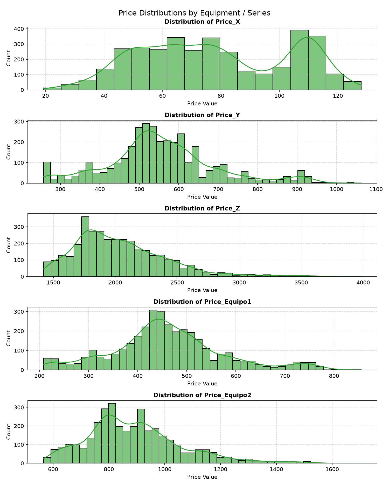
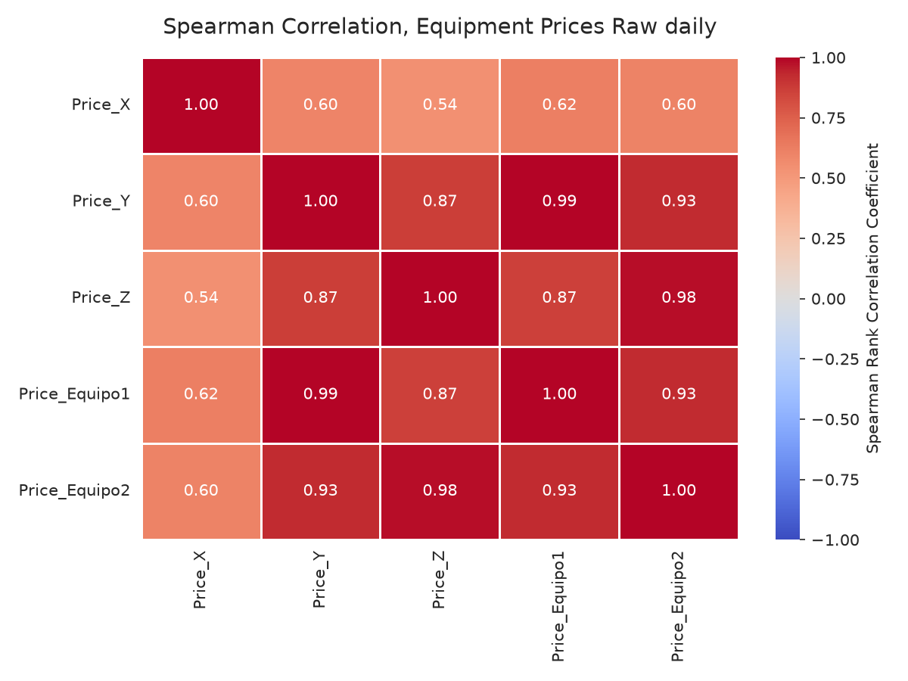
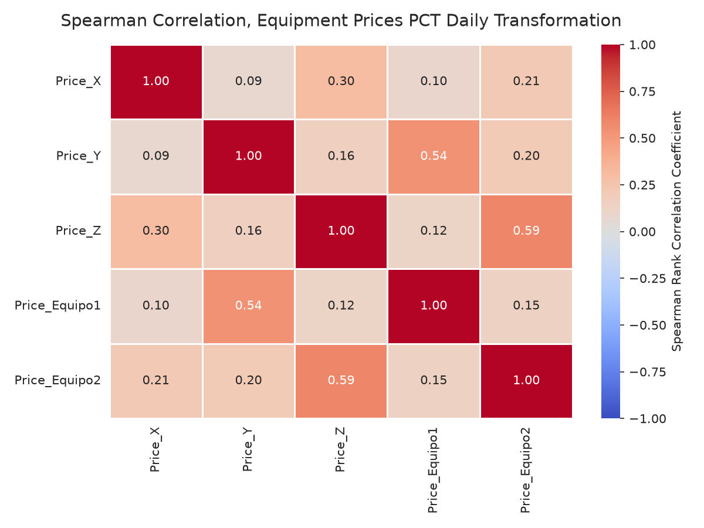
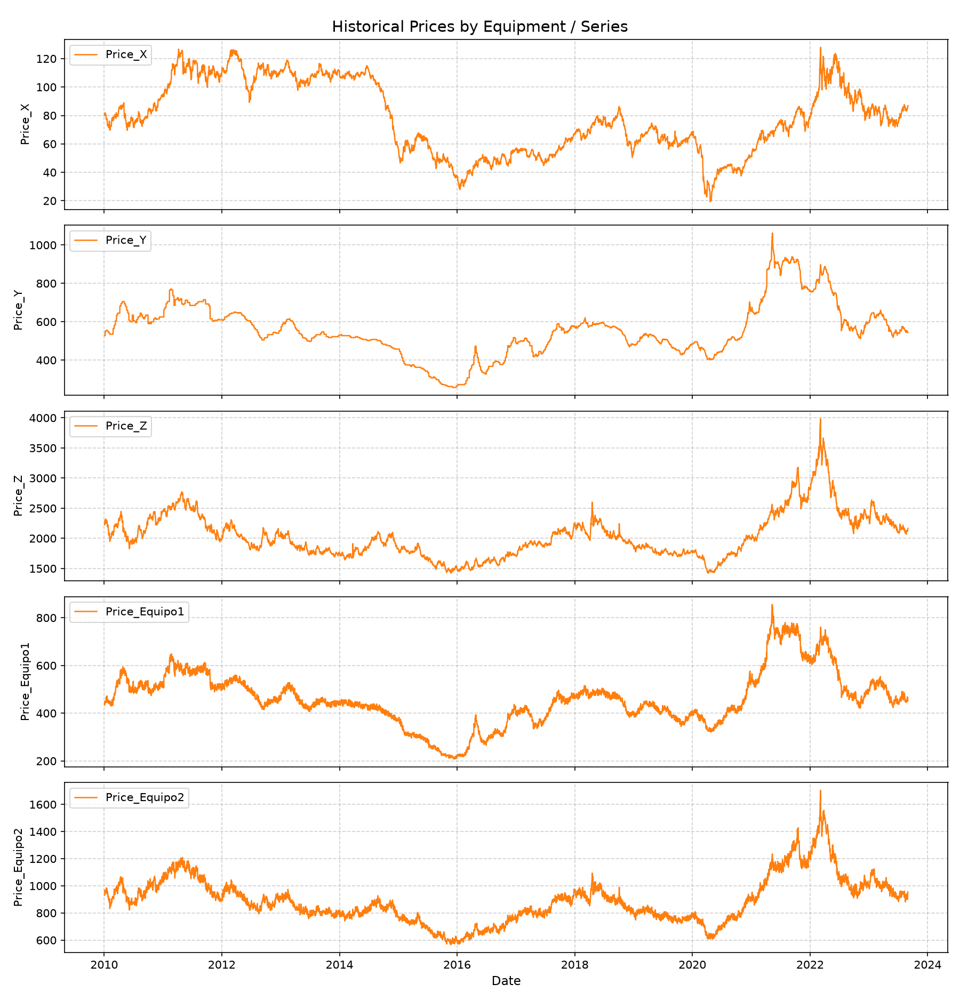
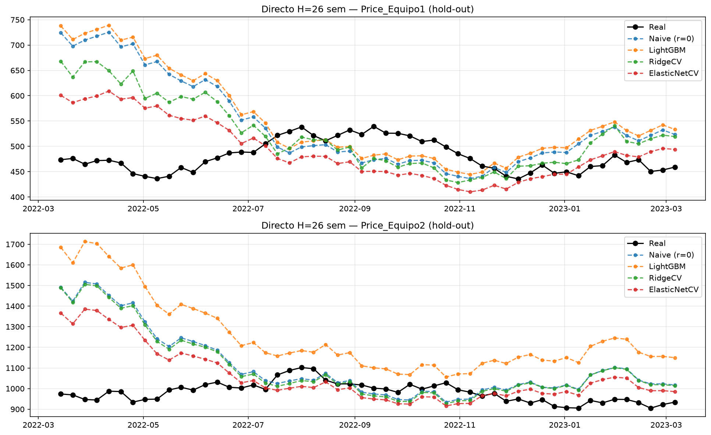
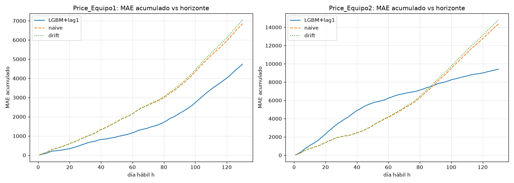
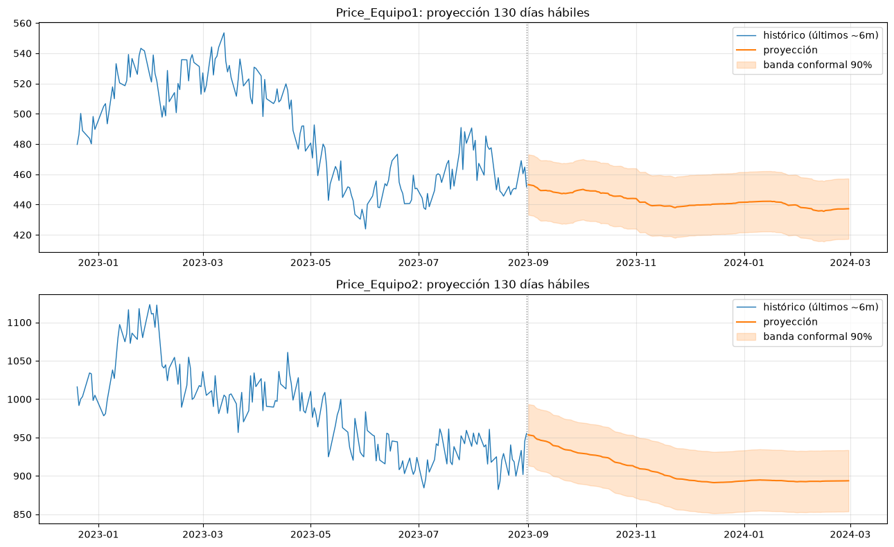
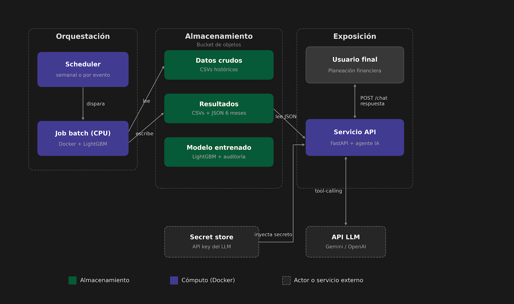

# Informe del caso — Proyección de costos de equipos de construcción

## Explicación del caso

Una empresa constructora debe gestionar el suministro continuo de dos equipos críticos (`Price_Equipo1` y `Price_Equipo2`) durante la ejecución de un proyecto. Históricamente los precios de adquisición han sido variables y difíciles de anticipar, generando desviaciones presupuestales recurrentes. La gerencia sospecha que los precios se relacionan con materias primas del mercado (`Price_X`, `Price_Y`, `Price_Z`), pero no existía un modelo formal que respaldara la hipótesis ni identificara qué insumos son determinantes para cada equipo.

**Objetivo del caso:** construir un mecanismo reproducible y sostenible en el tiempo que:

1. estime el costo de cada equipo,
2. identifique la relación con los insumos de mercado,
3. proyecte los costos futuros con incertidumbre cuantificada, como insumo de la planeación financiera del proyecto.

**Datos entregados:** serie diaria (días hábiles) desde 2010-01-04 hasta 2023-08-31 (3530 observaciones) con los precios de los dos equipos y tres series de insumos de mercado, más los CSV individuales de cada insumo (`X.csv`, `Y.csv`, `Z.csv`) usados para validación cruzada.

## Supuestos

1. **Serie diaria hábil consistente**: sin fechas inválidas, duplicados ni faltantes relevantes de días hábiles (verificado en EDA).
2. **Horizonte de planeación = 6 meses ≈ 130 días hábiles** se hace el supuesto de planeacion semanal por lo que se fija un horizonte de 6 meses; la proyección se emite en días hábiles.
3. **Modelo autónomo en producción**: no se asume disponibilidad garantizada de precios futuros de X/Y/Z. Los insumos se usan en el análisis exploratorio y en experimentos controlados, pero el modelo productivo opera solo con lags/rollings del propio target y variables de calendario, esto puede cambiar si existe un modelo previo que permita conocer dichos valores.
4. **Ventana de decisión**: la proyección recursiva parte desde el último dato disponible (2023-08-31); el rendimiento se valida con walk-forward expanding (3 folds × 130 días recursivos).
5. **Intervalos conformal split (nominal 90%)**: distribución-free pero de anchura constante; se reporta la cobertura real histórica (53–54%), sin prometer el 90% nominal.
6. **Determinismo** (semilla 21): el artefacto `.lgb` es caché regenerable; ante cambios de datos se reentrena automáticamente por evento.

## Formas para resolver el caso y la opción tomada en esta prueba

Se evaluaron varias alternativas antes de fijar la configuración productiva, en donde el mayor experimento y decision fue si se entrnaban modelos especialistas a H horzintes, o un modelo recursivo que iteraba +1 hasta llegar a H. 

| Alternativa | Estado | Razón |
|---|---|---|
| Red neuronal (LSTM/Transformer) | Descartada | Sin ventaja esperada sobre LightGBM con ~3.5k puntos y features de lags; mayor coste de tuning |
| Modelo con inferencia directa | Descartada | Mal desempeño a lo largo del tiemo; mayor correlacion en lag -1 |
| Modelo con insumos X/Y/Z | Experimento, no productivo | Techo +65%/+22% si la empresa proveyera insumos futuros; con proyecciones propias de insumos empeora vs autónomo |
| **Ensamble `w·lag1 + (1−w)·LightGBM` recursivo + conformal** | **ADOPTADO** | Supera al naive en walk-forward (−31%/−35%), simple, CPU, determinista e interpretable |

Dentro de los notebook de este repositorio se encuentran los diferentes enfoques, donde se rescatan a manera de resumen, estudio de correlacion antes y despues de calulo de retornos, modificacion en la granularidad de los datos, distribucion del tarjet y variables, etacionaridad y entrenamiento/experimentacion de modelos.

Distribuciones cargadas a izquierda dando pie a usar spearman en correlaciones.

Correlacion en datos crudos (sin transformar)

Correlacion en datos aplicando retornos, permitiendo ver que si existe relacion entre las variables x,y,z y los target pues prevalecen despues de transformacion. 

**Configuración final:** Eq1 con objetivo `regression_l2`, peso `w_lag1 = 0.7` y reentrenamiento cada 20 pasos; Eq2 con `regression_l1`, `w_lag1 = 0.9` sin reentrenamiento intermedio (seleccionadas por un barrido de 16 variantes en walk-forward). Features autónomos: lags del target (1…365), rollings (5/20/60/90) y calendario (día de semana, mes, tendencia). Hiperparámetros base (1500 árboles, lr 0.05, early stop 80).

**¿Por qué operar con peso bajo de ML sobre lag1?** La persistencia (lag1) hace el trabajo paso a paso y el LGBM corrige la deriva acumulada en 130 pasos recursivos (más peso de modelo = peor en el barrido). Para Eq2 la utilidad se concentra en el tramo 4.5–6 meses (45.2 vs 145.9 del naive), que es justo el horizonte de planeación.

**Inferencia** Por naturalidad de los datos (una unica catualizacion por dia), se propone una inferencia por lotes, en donde se corra un cronjob cada 15 dias, las predicciones son alojadas en formato JSON y CSV.

## Resultados del análisis de los datos y los modelos

**Análisis exploratorio:** las series no son estacionarias en nivel (ADF p > 0.1) y sí lo son en primera diferencia (p ≈ 0). Correlaciones de rendimientos: Y→Eq1 = 0.39, Z→Eq2 = 0.43, X ≈ ruido marginal. Validación cruzada de las 5 fuentes de datos: match 100%.

**Validación productiva (walk-forward expanding, 3 folds × 130 días recursivos, métricas medias):**

| Métrica (6 meses) | Eq1 modelo | Eq1 naive | Eq2 modelo | Eq2 naive |
|---|---|---|---|---|
| MAE | **36.46** | 52.67 | **72.38** | 110.41 |
| MAPE | **7.00%** | 10.40% | **6.33%** | 10.46% |
| Reducción vs naive | **−31%** | — | **−35%** | — |
| MAE a 3 meses (60d) | 19.41 | 35.98 | 104.15 | **69.06** |
| MAE a 4.5 meses (90d) | 24.21 | 39.90 | 85.64 | **87.21** |
| Cobertura banda 90% | 54% | — | 53% | — |

- **Eq1 supera al naive en todos los horizontes** evaluados.
- **Eq2 pierde a 3 meses pero gana con fuerza en 4.5–6 meses** (45.2 vs 145.9 en el tramo 61-130): su valor está en el horizonte de planeación.
- **Experimento con insumos:** con X+Y+Z reales, Equipo 1 Equipo 2 bajaron a un mae de 12.60 y  56.69 (techo de +65%/+22%). Con insumos proyectados univariadamente (naive o ARIMA propios): peor que el modelo autónomo por lo que se descartaron hasta que existan proyecciones externas confiables.

### Resultados de implementacion con inferencia directa

Donde se observa que los modelos para reducir el error optan por predecir el ultimo dato conocido, similar al naive baseline. 

## Proyección de costos y horizonte de predicción

**Horizonte: 130 días hábiles (6 meses)** — elegido por la ventana de planeación del proyecto y porque es el tramo en el que el modelo aporta sobre el baseline (especialmente Eq2 en 4.5–6 meses).

**Metodología:** pronóstico recursivo un paso adelante (con reentrenamiento cada 20 pasos para Eq1), ensamble con el lag-1, y bandas conformal split (q ≈ 20 para Eq1, q ≈ 40 para Eq2). Salida: `data/predictions/proyeccion_6m.json` y CSVs por equipo.

**Proyección vigente (corte de datos 2023-08-31; horizonte 2023-09-01 → 2024-02-29):**

| Equipo | Inicio → Fin | Δ | Banda (media) |
|---|---|---|---|
| Price_Equipo1 | 453 → 437 | −3.6% | ≈ [417, 467] |
| Price_Equipo2 | 953 → 894 | −6.3% | ≈ [853, 980] |

**Incertidumbre (honestidad estadística):** los intervalos tienen cobertura real histórica. Deben usarse como referencia asimétrica, no como garantía presupuestal. La degradación crece con el horizonte (cobertura de Eq1: 83% a h1-20 → 28% a h91-130). Para presupuesto se recomienda usar el punto central más una reserva derivada del MAE (≈ 7% Eq1, ≈ 6% Eq2 a 6 meses).

## Output final

Se observa que la solucion si bien no preve picos, es capaz de inferir la tendencia central y direccion de la serie.

## Agente

El agente implementado (`src/agent/`, API `src/api/main.py`) responde preguntas sobre la proyección usando siempr las herramientas get_metric y get_projections (evita alucinación de cifras) y distingue en su prompt(datos hasta 2023-08-31) de "conocimiento general del LLM". La solucion implentada unicamente consume un JSON, el cual es generado por el modelo de ml, dicho archivo contiene las inferencias acorde al horizonte y metadata de la prediccion para que el agente la tenga disponible. 

El modelo seleccionado de manera provisional fue gemini-flash-3.8, al ser un modelo que ofrece de manera gratuita cieron numero de peticones al dia, con capacidad de ejecutar la tarea solicitada. Para produccion es necesario cambiar dicho modelo.

Lo modelos de ML son modelos especializados, usualmente en hacer predciones, en un conjunto de datos en especifico. Un modelo entrenado para predecir la subida de precios del petroleo solo tendra esa capacidad, no podra predecir la subida de precios de el metal como ejemplo. Por su parte un agente se basa en modelos fundacionales, los cuales son modelos entrenado con millones de datos en diferentes areas, por lo que su aprendizaje va mas alla de un area en especifico, lo que hace diferente a un agente de un modelo fundacional, es su capacidad para reaccionar e interactuar con el mundo. Donde al modelo fundaciona se le dota con herramientas (Tools) que les permiten restroalimentarse con informacion actualizada, y la capacidad de reaccionar con es nueva informacion por medio de bucles.

## Cloud 

Se propone la siguiente arquitectura serverless, en donde se parte del supuesto que el area que consumira el agente y modelo, es el area de planeacion (Uso Interno). Por lo que se estima que no exista un consumo recurrente para utilizar aws bedrock o gcp agent platform, servicios que aumentan los costos de la implementacion.

| Componente abstracto | AWS | GCP |
|---|---|---|
| Bucket de objetos | S3 | Cloud Storage |
| Scheduler | EventBridge Scheduler | Cloud Scheduler |
| Job batch | ECS Fargate task / Batch | Cloud Run Job | 
| API gestionada | App Runner / ECS | Cloud Run | 
| Secret store | Secrets Manager | Secret Manager |

## Futuros ajustes o mejoras

1. **Conmutador por horizonte en Eq2:** naive para h ≤ 60 + modelo para h > 60 (mejora barata ya medida en sub-análisis).
2. **Reactivar insumos con proyecciones de la empresa** (no propias): el techo medido es +65%/+22% si X/Y/Z futuros son confiables.
3. **Búsqueda web en el agente IA** (limitación actual: el LLM no tiene noticias live) para contexto de mercado.
4. **Reentreno programado** (cron semanal) cuando haya datos nuevos, además del reentreno por evento.
5. **Tuning bayesiano con protocolo largo** implementar tune via optuna para mejorar los hyperparametros.
7. **Control de experimentos** Implmentar MLFlow para un registro en los experimentos asi como trazabilidad en los modelos.
9. **Interfaz del agente** El proyecto cuenta con la api para consumir al agente, sin embargo no se entrega una interfaz para interactuar con el agente de manera natural.
10. **GuardRails** Implementar guardrails sencillo, con el fin de evitar un mal uso del agente.

## Apreciaciones y comentarios del caso

- La hipótesis de la constructora (relación con materias primas) se **confirmó como techo** (+65%/+22% con insumos reales), pero **no es operable hoy** sin proyecciones externas de insumos; el modelo autónomo es la solución productiva mientras tanto.
- La decisión de modelar con peso bajo de ML sobre el lag-1 puede parecer "poco ML", pero es la configuración que **maximiza la utilidad medida** en el horizonte de planeación; el ML puro recursivo empeoraba la deriva acumulada.
- La limitación de cobertura de bandas se documenta en vez de ocultarse: para presupuesto, usar el punto central más una reserva derivada del MAE histórico.
- El pipeline completo es CPU, determinista y reproducible: un script (`python -m src.models.forecast`) regenera la proyección completa con caché por `data_cutoff`; el contrato de servicio es `proyeccion_6m.json`, consumible por finanzas, el agente IA y la API.
